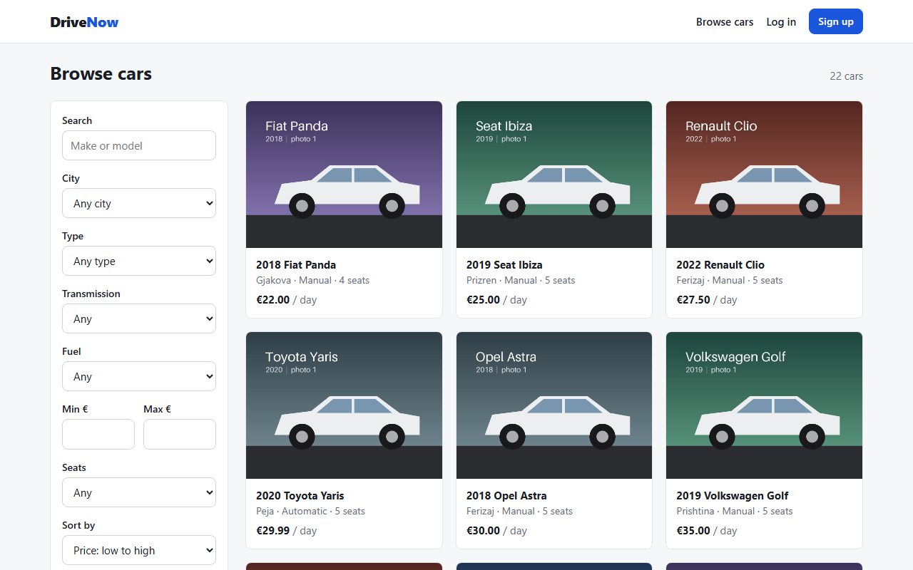
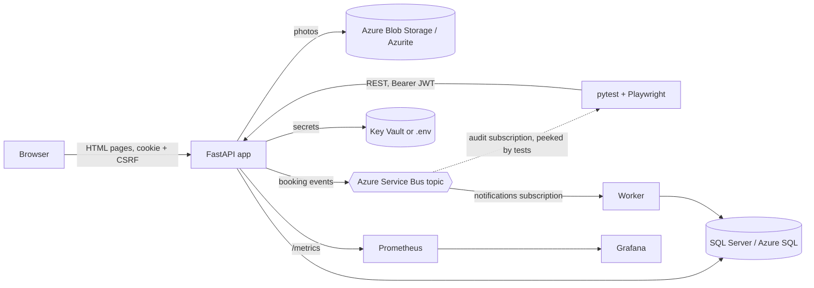
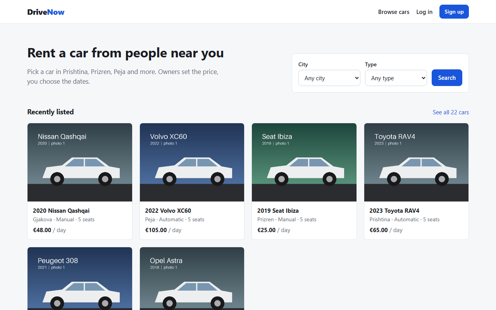
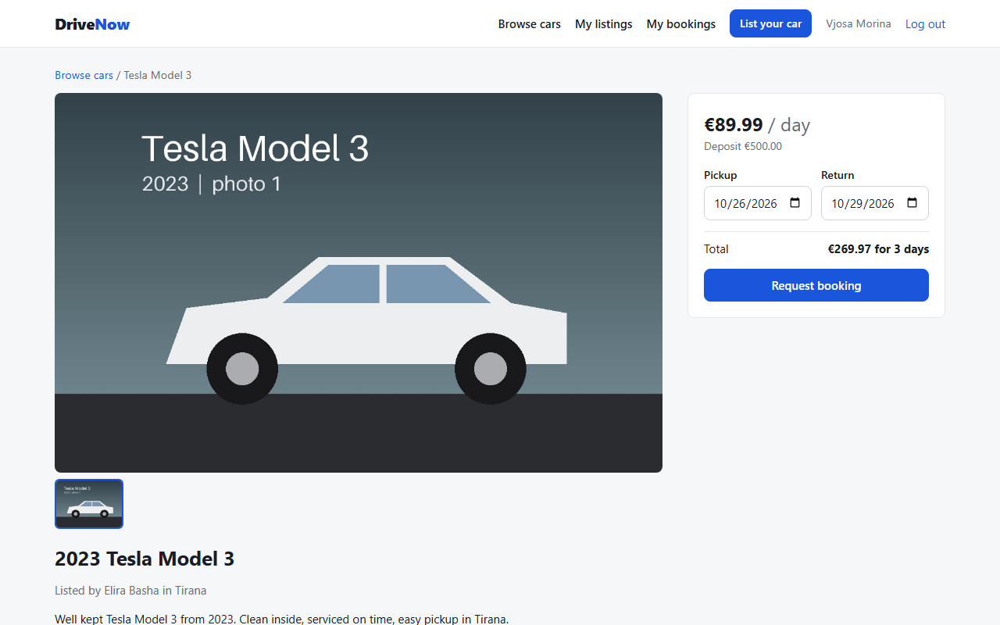
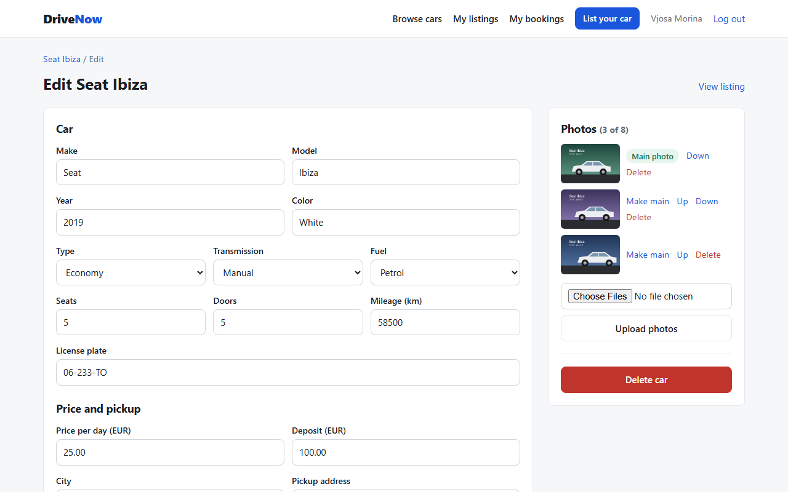
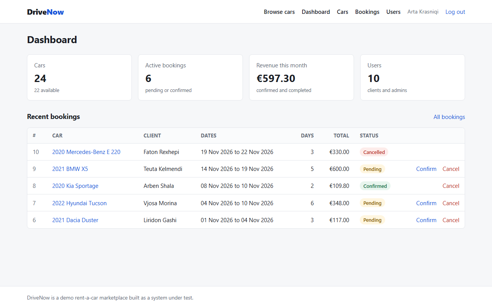
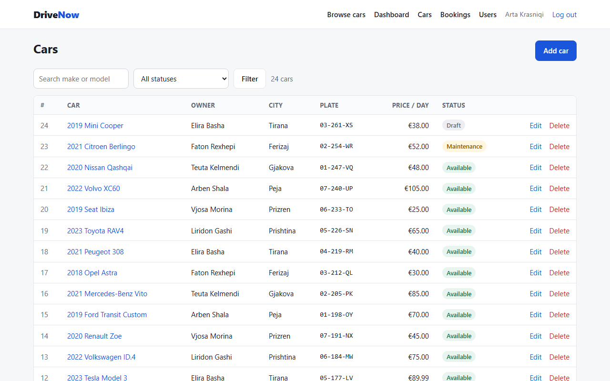
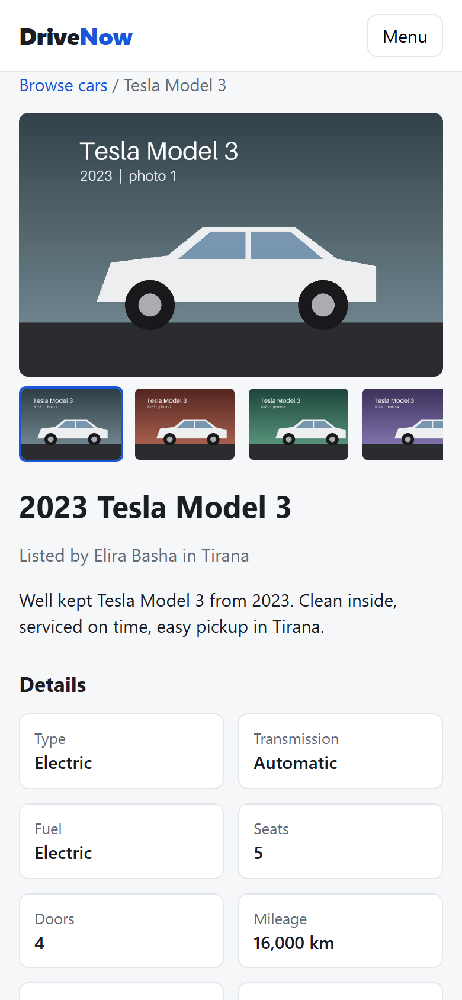

# DriveNow

DriveNow is a small rent-a-car marketplace: clients list their own cars, other clients book them,
admins manage everything. It is the **system under test** for my Python test automation framework,
[rentacar-qa-automation](https://github.com/arditgashii/rentacar-qa-automation), so it is built to be
tested: a documented REST API, stable `data-testid` attributes on every element, seeded accounts,
real Azure services running locally, and four [intentional bugs](docs/INTENTIONAL-BUGS.md) that the
test suite has to catch.



**Live demo:** https://drivenow-68x7.onrender.com (log in as `client1@drivenow.test` or `admin1@drivenow.test`, password `DriveNow!2026`; the free plan sleeps when idle, so the first request can take a minute).

## What it does

| Area | Features |
|---|---|
| Visitors | Browse and search cars (city, type, transmission, fuel, price range, seats, sort, pagination), car pages with a photo gallery |
| Clients | Sign up, log in, list a car with up to 8 photos, edit it, reorder photos and pick the main one, generate a description with an LLM, book other people's cars with a live price, cancel bookings, notifications |
| Admins | Dashboard with stats, manage every car, confirm or cancel bookings, activate, deactivate and promote users |

## Architecture



The web pages and the API call the same service functions, so a business rule behaves the same
in both. More reasoning in [docs/DECISIONS.md](docs/DECISIONS.md).

## Run it

**With Docker** (the real stack: SQL Server, Azurite, Service Bus emulator, worker):

```bash
docker compose up -d --build --wait
# open http://localhost:8000 and http://localhost:8000/docs
docker compose --profile observability up -d   # adds Prometheus (9090) and Grafana (3001)
DRIVENOW_BUGS=off docker compose up -d          # restart without the intentional bugs
docker compose down -v                          # stop and delete the data
```

**Without Docker** (SQLite, photos on disk, events in memory):

```bash
py -3.12 -m venv .venv          # python3.12 -m venv .venv on Linux/macOS
.venv\Scripts\activate          # source .venv/bin/activate on Linux/macOS
pip install -r requirements-dev.txt
copy .env.example .env          # cp .env.example .env on Linux/macOS
alembic upgrade head
python -m app.seed
uvicorn app.main:app --reload
```

**Public demo on Render:** [render.yaml](render.yaml) runs the same image as one container on the free plan, with SQLite, photos on disk and events in memory. In Render choose **New, Blueprint** and pick this repo; it generates the JWT secret itself. The free plan sleeps when idle and starts with fresh seed data each time.

## Seeded accounts

Every account uses the password `DriveNow!2026`.

| Role | Accounts |
|---|---|
| Admin | `admin1@drivenow.test`, `admin2@drivenow.test`, `admin3@drivenow.test` |
| Client | `client1@drivenow.test` to `client6@drivenow.test` |
| Inactive client (cannot log in) | `inactive@drivenow.test` |

The seed also creates 24 cars (22 available, one in maintenance, one draft) with 2 to 4 generated
photos each, and 10 bookings in every state.

## API

Swagger UI at `/docs`, OpenAPI JSON at `/openapi.json`. Everything lives under `/api/v1`:

| Method and path | Who |
|---|---|
| `POST /auth/register`, `POST /auth/login`, `GET /auth/me` | anyone, anyone, logged in |
| `GET /cars` (filters `q`, `city`, `category`, `transmission`, `fuel_type`, `min_price`, `max_price`, `seats`, `status`, `owner_id`, `sort`, `page`, `page_size`), `GET /cars/{id}` | anyone |
| `POST /cars`, `PUT/PATCH/DELETE /cars/{id}` | logged in; changes only by the owner or an admin |
| `POST /cars/{id}/photos`, `PATCH/DELETE /cars/{id}/photos/{photo_id}` | owner or admin |
| `POST /cars/{id}/generate-description` | owner or admin |
| `POST /bookings`, `GET /bookings`, `GET /bookings/{id}`, `POST /bookings/{id}/cancel` | clients (admins see all) |
| `POST /bookings/{id}/confirm`, `GET /admin/users`, `PATCH /admin/users/{id}`, `GET /admin/stats` | admins |
| `GET /notifications` | logged in |

Outside `/api/v1`: `GET /health` (version and git commit), `GET /health/ready` (database, blob
storage and bus), `GET /metrics`. Every error has the same shape:
`{"detail": "Readable message.", "code": "MACHINE_CODE"}`.

## Configuration

| Variable | Default | Meaning |
|---|---|---|
| `DATABASE_URL` | SQLite file | `mssql+aioodbc://...` for SQL Server or Azure SQL |
| `STORAGE_BACKEND` | `azure` | `azure` (Blob Storage or Azurite) or `local` (disk) |
| `AZURE_STORAGE_CONNECTION_STRING` | Azurite on localhost | Blob Storage connection |
| `MESSAGING_BACKEND` | `memory` | `servicebus` or `memory` |
| `SERVICEBUS_CONNECTION_STRING` | emulator on localhost | Service Bus connection |
| `SECRETS_BACKEND`, `KEY_VAULT_URL` | `env` | `keyvault` reads `jwt-secret` and `anthropic-api-key` from Azure Key Vault |
| `JWT_SECRET` | local value | Token signing key (at least 32 characters) |
| `DRIVENOW_BUGS` | `on` | Turns the [intentional bugs](docs/INTENTIONAL-BUGS.md) on or off |
| `LLM_PROVIDER`, `LLM_MODEL`, `ANTHROPIC_API_KEY` | `mock` | Car descriptions from the Anthropic API or from a local template |
| `OTEL_EXPORTER_OTLP_ENDPOINT` | empty | Send OpenTelemetry traces to this OTLP HTTP endpoint |
| `SEED_ON_START` | `false` | Seed the database when the container starts |

## Where each technology is used

| Technology | Where |
|---|---|
| Python 3.12, FastAPI, async SQLAlchemy, Pydantic | `app/` |
| Azure SQL (SQL Server 2022 in Docker), Alembic | `app/models.py`, `alembic/` |
| Azure Blob Storage (Azurite) | `app/storage.py` |
| Azure Service Bus (official emulator) | `app/messaging.py`, `app/worker.py`, `docker/servicebus-config.json` |
| Azure Key Vault | `app/secrets.py` |
| LLM feature with guardrails (Anthropic) | `app/llm.py` |
| Docker, Docker Compose | `Dockerfile`, `docker-compose.yml` |
| Kubernetes and Helm (AKS) | `deploy/helm/drivenow/` |
| Terraform (Azure resources incl. AKS, ACR, Key Vault, Service Bus, SQL) | `infra/terraform/` |
| Prometheus, Grafana, OpenTelemetry | `app/observability.py`, `docker/prometheus.yml`, `docker/grafana/` |
| GitHub Actions and Azure DevOps YAML | `.github/workflows/ci.yml`, `azure-pipelines.yml` |
| pytest unit and API tests | `tests/` |

## Development

```bash
ruff check . && ruff format --check .   # lint and format
mypy app                                # types
pytest -q                               # unit and API tests (bugs switched off)
```

## Screenshots

| | |
|---|---|
|  |  |
|  |  |
|  |  |
